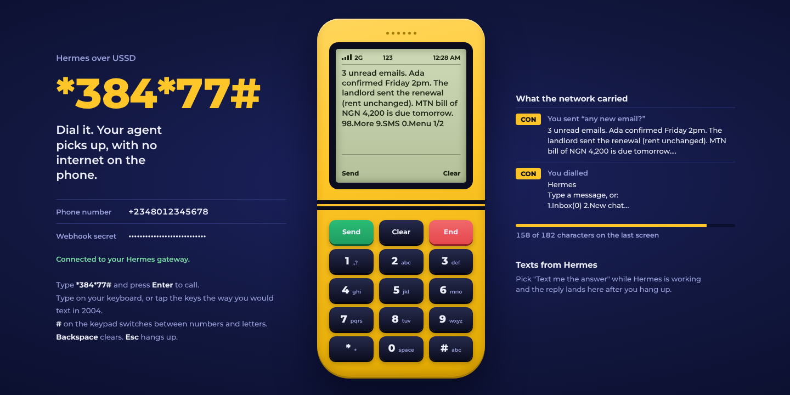
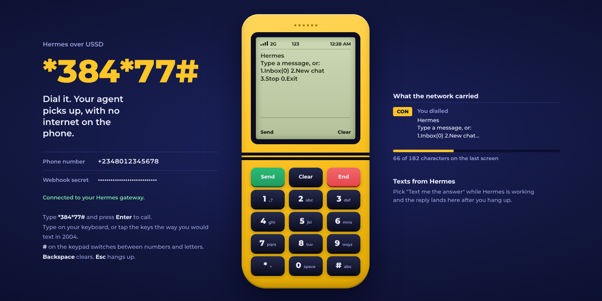
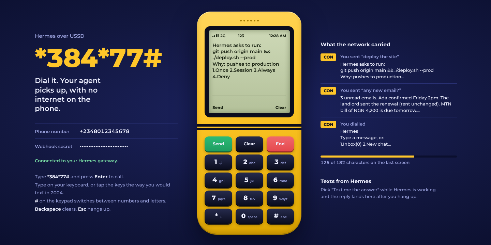
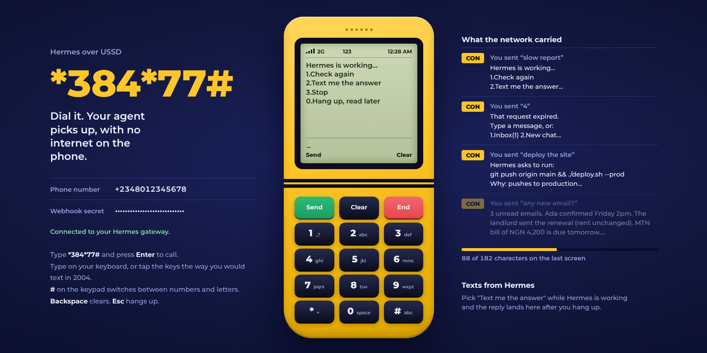
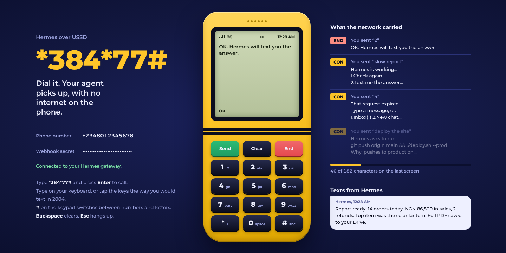

# Hermes over USSD

Talk to your Hermes agent from any phone by dialling a short code. No app, no data plan, no smartphone: a keypad and one bar of 2G are enough.



USSD is the `*123#` menu system every GSM phone has had since the 1990s. It is how hundreds of millions of people check airtime and move money, and it works where mobile data is expensive, slow or absent. This plugin makes it a Hermes gateway platform, so the same agent you reach on Telegram or the desktop also answers on a keypad phone.

It is a full platform adapter, not a prompt:

- **Replies become screens.** Agent output is stripped to GSM-7 text and paged to fit a 160-character screen, with `98.More` to continue.
- **Approvals become menus.** When the agent wants to run a risky command you get `1.Once 2.Session 3.Always 4.Deny`. The choices appear only after the last page of the command, so nobody approves a command they have not read to the end.
- **Slow turns survive the session.** A USSD session dies after a minute or two; an agent turn can take longer. Answers wait in an inbox that outlives the call, or arrive by SMS if you pick `Text me the answer`.
- **A dropped call resumes.** Dial again and you are on the page you were reading.
- **A simulator is built in.** Try everything on your own machine before you touch a telco.

## Try it in two minutes (no telco account)

```bash
hermes plugins install GodlyDeveloper1/hermes --enable

# ~/.hermes/.env
USSD_WEBHOOK_SECRET=<output of: openssl rand -hex 24>
USSD_ALLOWED_USERS=+2348012345678

hermes gateway run
```

Open <http://127.0.0.1:8788/sim>, paste the secret, type `*384*77#` and press Enter. Then type a message.

The simulator posts the same form data a real USSD gateway posts, so what works there works on a handset. It is served to requests from this machine only and is never visible through a tunnel.

| | |
|---|---|
|  |  |
|  |  |

## Put it on a real phone

The adapter speaks the [Africa's Talking USSD](https://developers.africastalking.com/docs/ussd/overview) callback format (`sessionId`, `phoneNumber`, `serviceCode`, `text`; reply `CON ...` or `END ...`), which several other aggregators share.

1. Create an Africa's Talking account and open the **sandbox** app (free).
2. Expose the local port with a tunnel, for example `ngrok http 8788` or `cloudflared tunnel --url http://127.0.0.1:8788`.
3. In the sandbox, create a USSD channel and set its callback URL to `https://<your-tunnel>/ussd/<USSD_WEBHOOK_SECRET>`.
4. Open the Africa's Talking simulator, enter a phone number that is in `USSD_ALLOWED_USERS`, and dial your channel's code.
5. For SMS delivery, add `AFRICASTALKING_USERNAME=sandbox` and a sandbox `AFRICASTALKING_API_KEY`.

Going live on real handsets means buying a short code from Africa's Talking (or your country's aggregator) and switching the username and key to your live app. Nothing in the plugin changes.

## On the keypad

| Screen | Keys |
|---|---|
| Home | type a message, or `1` inbox, `2` new chat (`/new`), `3` stop (`/stop`), `0` exit |
| Reading a reply | `98` next page, `9` send the rest by SMS, `0` menu, anything else is your reply |
| Hermes is working | `1` check again, `2` text me the answer, `3` stop, `0` hang up and read later |
| Approval | `98` next page, `0` deny at any point, the numbered choices on the last page |

Clarifying questions from the agent arrive as numbered options; reply with the number.

## Configuration

Set these in `~/.hermes/.env` (or the profile's `.env`), or under `gateway.platforms.ussd.extra` in `config.yaml`.

| Variable | Default | Purpose |
|---|---|---|
| `USSD_WEBHOOK_SECRET` | required | 16+ random characters. Forms the callback path `/ussd/<secret>`. |
| `USSD_ALLOWED_USERS` | | Comma-separated phone numbers that may use the agent, international format (`+234...`). |
| `USSD_ALLOW_ALL_USERS` | `false` | Let any caller in. Only for a private short code. |
| `USSD_PIN` | | Ask for this PIN at the start of every call. Three misses lock the number for 15 minutes. |
| `USSD_HOME_CHANNEL` | | Phone number for cron and notification deliveries (sent by SMS). |
| `AFRICASTALKING_USERNAME` | | Enables SMS. `sandbox` selects the sandbox API. |
| `AFRICASTALKING_API_KEY` | | Africa's Talking API key for SMS. |
| `AFRICASTALKING_SENDER_ID` | | Optional registered sender ID or short code. |
| `USSD_WEBHOOK_HOST` / `USSD_WEBHOOK_PORT` | `127.0.0.1` / `8788` | Where the callback server listens. |
| `USSD_SCREEN_CHARS` | `160` | Characters per screen (60 to 182). |
| `USSD_HOLD_SECONDS` | `6` | How long a screen waits for a quick answer before showing "working". |
| `USSD_SIMULATOR` | `true` | Serve the simulator at `/sim` to this machine. |

## Security model

USSD gateways do not sign their callbacks, so the plugin is built around that:

- **The callback URL is the credential.** Requests to any path other than `/ussd/<secret>` get a 404, compared in constant time. The adapter refuses to start with a secret shorter than 16 characters and never writes the path to the access log. Use an HTTPS tunnel or reverse proxy in front of it.
- **Phone numbers come from the network, not the caller.** The number in a callback is set by the operator. `USSD_ALLOWED_USERS` is checked before anything reaches the agent, and Hermes's own allowlist and pairing checks run after it.
- **A PIN covers a lost SIM.** With `USSD_PIN` set, holding the phone is not enough.
- **Approvals are bound to their request.** A keypad answer settles only the approval that menu was drawn for, through Hermes's `resolve_gateway_approval_card`, with the same requester check the built-in platforms use. A command with characters a GSM screen cannot show exactly (a backtick, an emoji) can be denied from the phone but not approved.
- **The simulator stays local.** `/sim` and its SMS tray answer only loopback requests with no proxy headers.

## Disclosures

- **Network, inbound:** runs an HTTP server on `127.0.0.1:8788` by default while the gateway is running. You decide whether to expose it through a tunnel or proxy.
- **Network, outbound:** only when `AFRICASTALKING_USERNAME` and `AFRICASTALKING_API_KEY` are set, message text and the recipient's phone number are sent to `api.africastalking.com` (or `api.sandbox.africastalking.com`) to deliver SMS. Nothing else leaves the machine. No telemetry.
- **Third parties see your messages.** USSD and SMS are not end-to-end encrypted: the mobile operator and the aggregator can read what you type and what the agent answers. Do not use it for secrets.
- **Credentials:** read through Hermes's scoped secret store. The plugin stores no tokens of its own.
- **State:** inboxes and sessions are kept in memory and are lost when the gateway restarts. Nothing is written to disk.
- **No shell commands, no background processes** beyond the HTTP server above, and no self-update.

## Limits worth knowing

- Text only. Images, files and voice do not exist on USSD.
- Operators cap a USSD session at roughly one to three minutes. The inbox and SMS paths exist for exactly that.
- Letters outside the GSM-7 alphabet are folded to plain ones and emoji are dropped.
- The wire format is Africa's Talking's. Other aggregators with the same four fields work as they are; others need a small change in `adapter.py`.

## Development

```bash
# engine only, no Hermes needed
python -m pytest -c tests/pytest.ini --rootdir tests tests/test_engine.py

# everything, from a Hermes checkout's virtualenv
python -m pytest -c tests/pytest.ini --rootdir tests tests/

# the check the catalog CI runs
hermes plugins validate . --install-deps
```

`engine.py` holds all screen logic and has no Hermes imports. `adapter.py` is the gateway and HTTP glue. `simulator/index.html` is one page with no remote dependencies: its typeface, Montserrat, is bundled in `simulator/montserrat.woff2` and served from your machine.

## License

MIT. The bundled Montserrat font is by The Montserrat Project Authors, under the SIL Open Font License 1.1 (`simulator/OFL.txt`).
